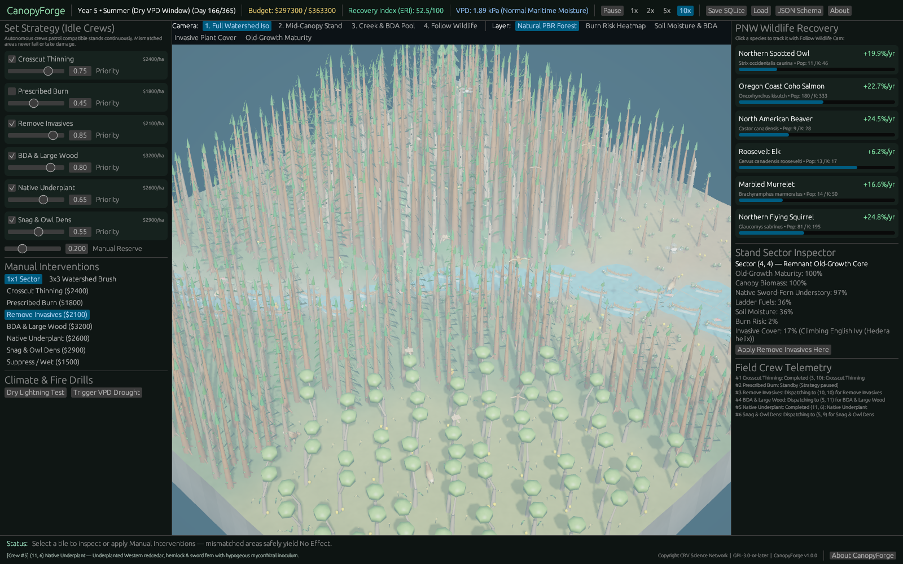

# CanopyForge (`canopyforge` v1.0.0)

Native safe-Rust (`#![forbid(unsafe_code)]`) 3D isometric and zoomable Pacific Northwest (PNW) old-growth forest restoration "idle + active stewardship" simulation game built on `eframe`/`egui` `0.31`, `wgpu` `24.0` WGSL PBR shaders, `glam` `0.29`, `rusqlite` `0.32` (WAL mode), and `clap` `4.5`.



## Documentation

- [User Guide](docs/USER_GUIDE.md) — Interactive controls, Inspect vs. Apply click modes, dry-run hover tooltips, multi-slot SQLite saves, and annual audit charts.
- [Scientific Methods & Equations](docs/SCIENTIFIC_METHODS.md) — Seasonal VPD curve (`Season::Summer` peak), offshore east-wind (`-X`) fire percolation, BDA hyporheic fire refugia, `256 ha` Spotted Owl habitat suitability index, and logistic wildlife recovery equations.

## Scientific Summary

- **5 Grounded PNW Watershed Ecotypes (`256 ha`, `16 × 16` sectors)**:
  - **Remnant Old-Growth Core**: 250–750 year *Pseudotsuga menziesii*, *Thuja plicata*, *Tsuga heterophylla*, mossy nurse logs, and *Polystichum munitum* sword-fern understory.
  - **Dense Second-Growth Plantation**: Overstocked even-aged conifer stand with continuous ladder fuels and elevated crown-fire hazard.
  - **Incised Salmonid Creek Corridor**: Meandering Coast Range stream (`NE → SW`) enhanced by Beaver Dam Analogues (BDAs) and instream Large Woody Debris (LWD) that recharge neighboring soil moisture and act as **fire refugia**.
  - **Degraded Clearcut Edge & Upland Oak-Conifer Meadow Ridge**: Colonized by *Rubus armeniacus* (Himalayan blackberry), *Cytisus scoparius* (Scotch broom), and *Hedera helix* (English ivy).
- **Non-Failure Stewardship Invariant**:
  - **6 Autonomous Field Crews** + **7 Manual Interventions** (`1×1` sector or `3×3` brush) never harm the ecosystem; mismatched sectors return `NoEffectNeutral` at `$0` cost with live dry-run hover previews.
- **Seasonal VPD Drought, East-Wind Fire Percolation & 3D PBR Rendering**:
  - Atmospheric Vapor Pressure Deficit (`VPD kPa`) peaks cleanly inside `Season::Summer` (day `145`), modulated dynamically in the WGSL shader via `sun_color_and_vpd.w`, seasonal solar elevation/tint, wildfire smoke density, `NE → SW` creek wave advection, single-gamma sRGB/linear tonemapping (`apply_gamma`), and dirty-flag cached static terrain/conifer geometry.
- **6 PNW Indicator Wildlife Species (`src/agents.rs`)**:
  - Tracks **Northern Spotted Owl** (*Strix occidentalis caurina*, calibrated as a `256 ha` sub-basin habitat suitability index `K ≤ 12.0` reflecting `> 1,000 ha` regional home ranges), **Oregon Coast Coho Salmon** (*Oncorhynchus kisutch*), **North American Beaver** (*Castor canadensis*), **Roosevelt Elk** (*Cervus canadensis roosevelti*), **Marbled Murrelet** (*Brachyramphus marmoratus*), and **Northern Flying Squirrel** (*Glaucomys sabrinus*), dynamically spawning and pruning visible 3D wildlife agents as populations change.

## Controls & Hotkeys

All keyboard shortcuts are guarded by `!ctx.wants_keyboard_input() && !json_modal_open` so typing into save-slot names or the JSON modal never pans or pauses the simulation.

| Input | Action | Notes |
| --- | --- | --- |
| `Left Click` | Inspect or Apply Manual Tool | Toggled via `Click: Apply Tool` vs `Click: Inspect Only` |
| `Hover Sector` | Live dry-run preview tooltip | Shows `EffectiveSuccess` vs `NoEffectNeutral` and exact `$` cost |
| `Right Drag` or `Q` / `E` | Orbit camera azimuth/pitch | Smoothly orbits watershed diorama (`14°`–`68°` pitch) |
| `Middle Drag` or `W` `A` `S` `D` | Pan planar target | Pans across forest stands and stream reaches |
| `Scroll Wheel` | Smooth zoom (`8.5`–`82.0`) | Telephoto isometric outside → wide perspective inside canopy |
| `1` / `2` / `3` / `4` | Camera presets | `1` Iso, `2` Mid-Canopy, `3` Creek & BDA, `4` Follow Wildlife |
| `Space` | Pause / Resume simulation | Halts ecological tick while keeping camera navigation active |
| `[` / `]` | Step simulation speed | Cycles `1×`, `2×`, `5×`, `10×` |
| `Ctrl+K` | Fuzzy Command Palette | Jump to ecotypes, stewardship actions, seasons, annual audit & exports (`Up`/`Down`/`Enter`/`Esc`) |
| `F1` / `Esc` | Toggle / Close modals | Closes palette, annual audit, JSON Schema modal, or About dialog |

## CLI Flags

`--seed` is a **global** argument and can be placed either before or after subcommands (for example, `simulate --years 12 --seed 42` or `--seed 42 simulate --years 12`).

| Flag / Subcommand | Default | Description |
| --- | --- | --- |
| *(default)* or `gui` | `gui` | Launch the hardware-accelerated `wgpu` 3D desktop workstation |
| `simulate --years <N>` | `8` | Run headless multi-year stewardship audit and print ERI, grant, and wildlife summary |
| `scorecard --years <N> --out-dir <dir>` | `100`, `exports` | Compare 100-year Passive vs. Balanced vs. Severe Drought scenarios & export JSON/CSV scorecard |
| `--export-json <path>` | — | Export final `SimulationSaveState` JSON snapshot after `simulate` |
| `--seed <u64>` *(global)* | `2026` | Deterministic `ChaCha8Rng` watershed generation seed |
| `--headless-screenshot <path>` | — | Render offscreen `1600×1000` `Rgba8Unorm` PNG (with `1/2.2` gamma encoding) |
| `--screenshot-view <1\|2\|3>` | `1` | Headless capture preset (`1` = Full Iso, `2` = Mid-Canopy, `3` = Creek & BDA) |

## Quickstart

```bash
# Run full unit, CLI, and ecological invariant test suite
cargo test --all-targets

# Launch the interactive 3D wgpu + egui desktop game
cargo run --release

# Run headless multi-year benchmark (global --seed works anywhere)
cargo run --release -- simulate --years 12 --seed 42 --export-json audit_run.json

# Export 100-year Passive vs. Balanced vs. Severe Drought restoration scorecard (JSON + CSV)
cargo run --release -- scorecard --years 100 --out-dir exports --seed 2026

# Render offscreen 1600x1000 WGPU PBR PNG screenshots
cargo run --release -- --headless-screenshot validation/headless_screenshot.png --screenshot-view 1
```

## Validation & Quality Metrics

- **Automated Tests (`cargo test --all-targets`)**: `22/22` passing (`5` library unit tests + `4` CLI parser tests + `13` ecological invariant, palette & 100-year scorecard integration tests; `0` failed, `0` ignored), verifying zero-harm intervention compatibility, success-scaled annual budgets, summer VPD peak alignment, offshore east-wind (`-X`) wildfire advection, `256 ha` Spotted Owl habitat calibration & excess agent pruning, SQLite WAL & JSON round-trips, finite multi-part 3D geometry, `Ctrl+K` fuzzy command palette navigation, 100-year watershed scenario scorecards, and global `--seed` CLI parsing.
- **Validation Artifacts**: See [validation/canopyforge_validation_summary.json](validation/canopyforge_validation_summary.json), `1600×1000` headless renders in `validation/`, companion preprint [`Preprints/`](Preprints/README.md) (`APP-PREPRINT-23`, Zenodo Concept DOI [`10.5281/zenodo.24442091`](https://doi.org/10.5281/zenodo.24442091)), and [`CITATION.cff`](CITATION.cff).

## License & Attribution

Licensed under the **GNU General Public License v3.0 or later (`GPL-3.0-or-later`)**. See [LICENSE](LICENSE) for full terms.

- **Repository**: <https://github.com/bpwhite/crvscience-canopyforge>
- **Zenodo Concept DOI**: <https://doi.org/10.5281/zenodo.24442091>
- **CRV Science Open-Source Apps**: <https://crvscience.com/apps>
- **Copyright**: Copyright CRV Science Network (<https://crvscience.com>)
